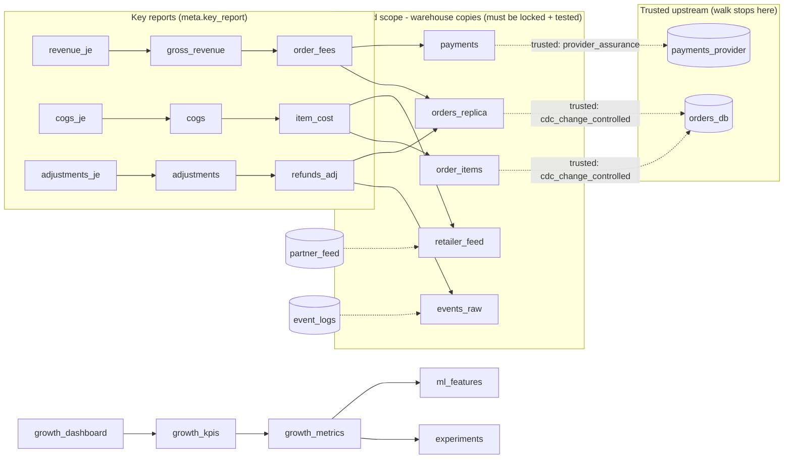

# Lineage Gate

A working miniature of a **self-enforcing scope control for financial data**.
Key reports (journal-entry feeds) declare themselves in dbt; CI walks lineage
backward from them to a trust boundary, computes the exact set of tables that
feed the numbers, and fails the PR closed if anything in that scope is not
locked down and covered by integrity checks. A second control watches the query
log and flags writes to locked tables by anyone who isn't a system identity or
a reviewed break-glass ticket. Everything runs locally against DuckDB - no
cloud, no credentials, no signups.

## Lineage



Trust belongs to the **upstream system** (`orders_db` via CDC,
`payments_provider` via provider assurance) - but the warehouse copy is ours
to defend. Trusted nodes are the boundary where the walk stops, yet they stay
in scope: `orders_replica`, `payments` and `order_items` must be locked down
and carry integrity checks like every other in-scope node. The gate reports
the boundary as the upstream, e.g. `trusted boundary: orders_db (via
orders_replica)`.

`growth_dashboard` has no `key_report` flag, so its lineage
(`experiments`, `ml_features`) never enters scope. `ml_features` starts
unlocked and untested - it only becomes a violation when someone pulls it
into a key report's lineage (which the demo does).

## Run it

```bash
make setup       # uv sync (Python 3.12, dbt-core + dbt-duckdb)
make build       # dbt build - seeds, models, integrity tests (must pass)
make gate        # lineage gate - computes scope, enforces lockdown.yml
make monitor     # write monitor over controls/sample/query_log.csv
make demo        # interactive walkthrough (pauses for Enter)
make demo-auto   # same walkthrough, no pauses
make test        # pytest
```

`make gate` exits 1 on any finding and always writes
`controls/out/scope.json` (key report -> in-scope nodes + trusted boundary).

## Components -> controls

| Component | File | Control it represents |
|---|---|---|
| dbt sources + `meta.trusted` / `meta.upstream` | `warehouse/models/sources.yml`, `warehouse/seeds/schema.yml` | **Trust boundary** - which upstreams are trusted and why; warehouse copies stay in scope |
| `parent_map` walk from key-report exposures | `controls/lineage_gate.py` | **Computed scope** - lineage decides what must be governed |
| Required check `lineage-gate` on `pull_request` | `.github/workflows/lineage-gate.yml` | **Fail closed at merge** - drift can't ship |
| `controls/lockdown.yml` + `consumed_by` | `controls/lockdown.yml` | **Least privilege from one config** - every control reads the same list |
| Integrity tests (`not_null`, `unique`, `row_count_not_empty`) | `warehouse/**/schema.yml`, `warehouse/macros/` | Scope members must prove they are tested, not just listed |
| `controls/write_monitor.py` + sample logs | `controls/write_monitor.py`, `controls/sample/` | **Tamper detection** - non-system writes to locked tables alert |

## What the full-scale version adds

- **Column-level lineage** - scope computed at column granularity, not just
  table granularity.
- **Manual verification** - pipelines not declared in dbt are verified by hand
  and recorded, instead of silently escaping the walk.
- **Quarterly publishing** of the controlled report list - key reports are a
  published, reviewed inventory, not just a flag in code.
- **Retroactive chain of custody** for late reports - reports added after the
  fact get their lineage reconstructed and scoped retroactively.
- **Scored access requests with SME review** - break-glass and standing access
  are scored and reviewed by subject-matter experts, not just ticket-matched.

## Layout

```
warehouse/           dbt project (seeds = warehouse tables, models = marts)
controls/            lockdown.yml, lineage_gate.py, write_monitor.py, sample/
demo/                patches + scripted walkthrough (demo.py)
tests/               pytest for gate and monitor
.github/workflows/   required lineage-gate check + dbt build job
```
